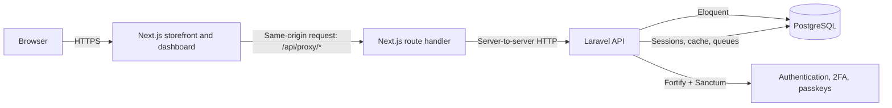
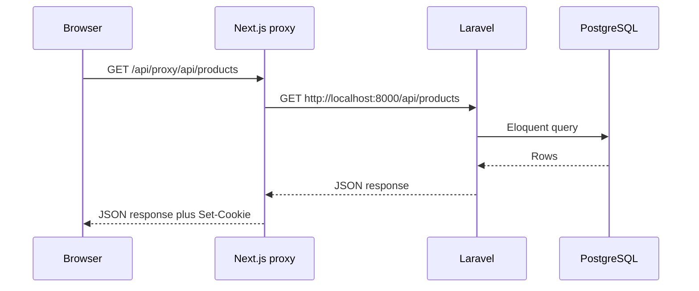
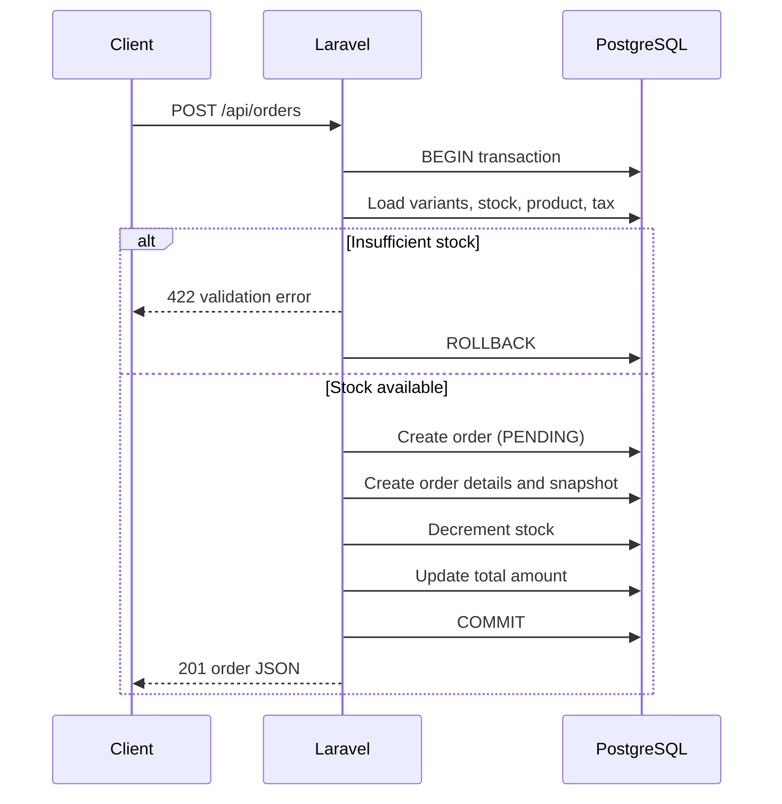
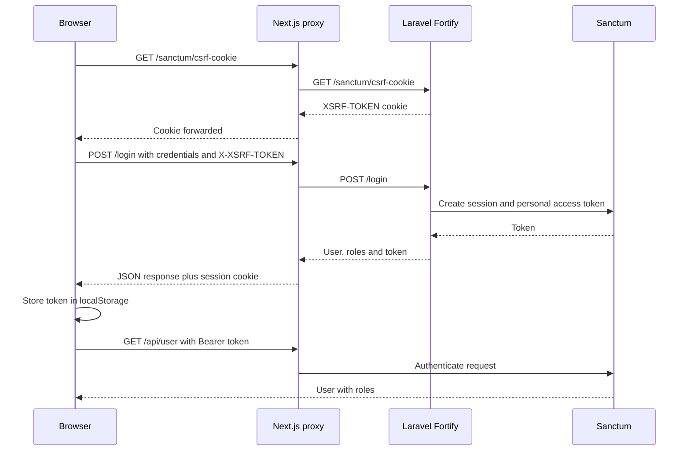
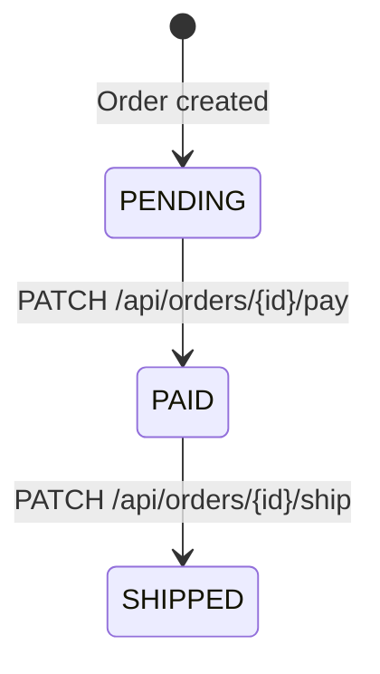
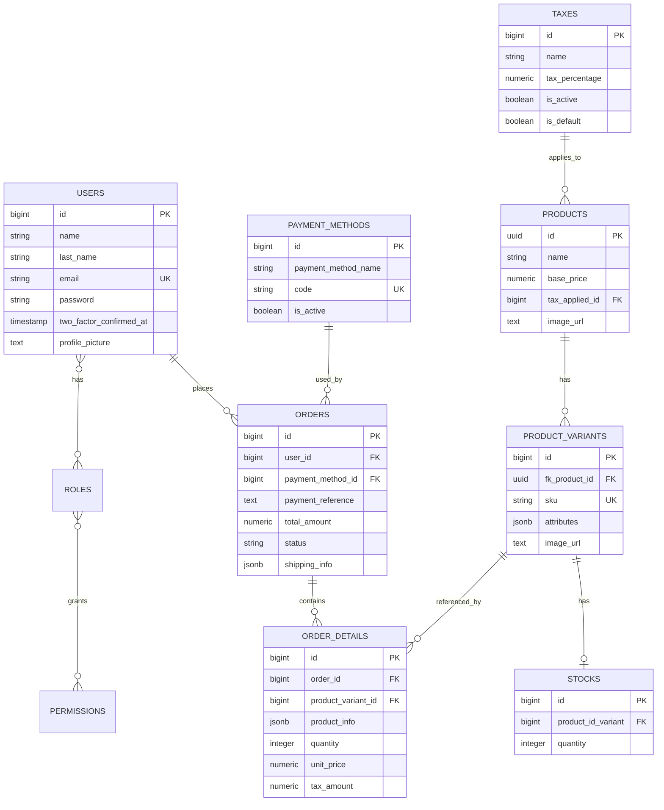

# LUX STORE (E-commerce)

LUX STORE is a full-stack e-commerce application for a fictional luxury and streetwear clothing brand. It combines a localized Next.js storefront with an authenticated admin dashboard and a Laravel REST API backed by PostgreSQL.

This repository is the public preview of the project. It shares the design, architecture and engineering decisions behind the application. A more robust version is under active development. This README is explicit about what is live in the public build and what is already implemented in the backend but not yet connected to the storefront.

### **OFFICIAL RELEASE:** https://lux-clothing-store.vercel.app

### Main Stack:

#### Frontend:


#### Backend:


### Design Tools:


### AI Assistant Tools:


## Table of contents

- [1. Why this project exists](#why-this-project-exists)
- [2. Current status](#current-status)
- [3. Features](#features)
- [4. Technology stack](#technology-stack)
- [5. Repository structure](#repository-structure)
- [6. Architecture](#architecture)
- [7. How data travels](#how-data-travels)
- [8. Authentication flow](#authentication-flow)
- [9. Order lifecycle](#order-lifecycle)
- [10. Data model](#data-model)
- [11. API reference](#api-reference)
- [12. Getting started](#getting-started)
- [13. Environment variables](#environment-variables)
- [14. Testing](#testing)
- [15. Design decisions](#design-decisions)
- [16. Security notes](#security-notes)
- [17. Current limitations and roadmap](#current-limitations-and-roadmap)
- [License](#license)

## Why this project exists

The goal is to build a realistic commerce system, not only a storefront mockup. The project explores the parts that make an e-commerce application dependable:

- A clear separation between the customer-facing application and the API.
- Server-side pricing, tax calculation and stock validation so the client cannot tamper with order totals.
- Role-based access control for administrators and customers.
- A complete authentication surface: registration, login, password reset, two-factor authentication and passkeys.
- Internationalization for a multilingual audience.
- An admin dashboard for products, variants, stock, taxes, payment methods, orders and users.

The public version prioritizes a polished storefront and a visual preview of the catalog. The robust version being developed focuses on connecting the full commerce flow end to end: real catalog data from the API, checkout inside the application, payment integration, media storage and deployment hardening.

The brand name is fictional and is used only for this project.

## Current status

The project is a working full-stack application with some intentional boundaries in the public build.

| Area                                                                | Status                                                       |
| ------------------------------------------------------------------- | ------------------------------------------------------------ |
| Storefront pages, product detail, cart, search                      | Live in the public build                                     |
| Multilingual UI (English, Spanish, French, Italian)                 | Live in the public build                                     |
| Authentication, password reset, two-factor authentication, passkeys | Live through Laravel Fortify                                 |
| Admin dashboard and role guard                                      | Live in the public build                                     |
| Product, tax, payment method and user management APIs               | Live in the backend                                          |
| Order creation API with stock validation and server-side totals     | Live in the backend and covered by tests                     |
| Public storefront checkout                                          | Uses a concierge flow that redirects to Instagram DM         |
| Storefront product listing                                          | Uses a curated local dataset in `frontend/app/data/prods.ts` |
| Real payment gateway                                                | Not implemented                                              |
| Catalog to API connection in the storefront                         | Planned                                                      |

The order API and the storefront checkout are intentionally documented as separate pieces. The commerce domain logic exists and is tested, but the public storefront currently hands the final purchase conversation to a human channel.

## Features

### Storefront

- Landing page and product catalog with filters and sorting.
- Product detail page with variants, stock display and quantity selection.
- Client-side shopping cart persisted in `localStorage`.
- Search dialog across the local catalog.
- Four locales with locale-prefixed routes: `/en`, `/es`, `/fr`, `/it`.
- Light and dark theme support.
- Responsive layout built with Tailwind CSS and shadcn/ui components.

### Accounts and security

- Registration and login through Laravel Fortify.
- Password reset flow.
- TOTP two-factor authentication with QR code, secret and recovery codes.
- Passkey support configured through Fortify.
- Cookie-based Sanctum sessions plus a bearer token fallback.
- Login, two-factor and passkey rate limiting.

### Administration

- Admin-only dashboard protected by a role check on the client and enforced again by the API.
- Overview metrics and charts.
- Order list with status filters, search, CSV export, and actions to mark orders as paid or shipped.
- Product creation and editing, variant updates, stock updates and variant images.
- Tax management.
- Payment method management with a default method.
- User list with roles and order counts.

### Backend domain

- Product, variant, stock, tax, order, order detail, payment method and user models.
- Transactional order creation.
- Stock validation before an order is accepted.
- Price and tax calculation on the server.
- Product snapshots inside order details so historical orders stay readable if the catalog changes later.
- Role and permission tables through Spatie Laravel Permission.

## Technology stack

| Layer                | Technology                                                            |
| -------------------- | --------------------------------------------------------------------- |
| Frontend framework   | Next.js 16 (App Router, Turbopack)                                    |
| UI                   | React 19, Tailwind CSS 4, shadcn/ui, Radix UI, Lucide                 |
| Data fetching        | Axios with a same-origin Next.js proxy                                |
| Frontend state       | React Context for the cart, local component state                     |
| Internationalization | next-i18n-router, i18next, react-i18next                              |
| Backend framework    | Laravel 13, PHP 8.3                                                   |
| Authentication       | Laravel Fortify, Laravel Sanctum, two-factor authentication, passkeys |
| Authorization        | Spatie Laravel Permission (`admin` and `user` roles)                  |
| Database             | PostgreSQL 18 (schema dump included)                                  |
| Session and cache    | Database-backed drivers                                               |
| Testing              | Pest and PHPUnit on the backend, ESLint on the frontend               |

## Repository structure

```text
e-commerce-app/
  README.md
  backend/
    app/
      Actions/Fortify/          Registration, password and profile actions
      Http/Controllers/API/     REST controllers
      Models/                   Eloquent models
      Providers/                Fortify and application providers
    bootstrap/app.php           Middleware, CSRF exceptions, JSON errors
    config/                     Laravel configuration
    database/
      schema/pgsql-schema.sql   PostgreSQL schema dump
      seeders/                  Roles and demo users
    routes/
      api.php                   Application API routes
      web.php                   Sanctum CSRF cookie route
    tests/                      Feature and unit tests
    seed_payment_methods.php    Optional local payment method seed script
    seed_product_and_order.php  Optional local demo data script
  frontend/
    app/
      [locale]/                 Localized pages
      api/proxy/[...path]/      Server-side proxy to Laravel
      data/prods.ts             Curated local catalog data
    components/
      luxcomp/                  Storefront components
      forms/                    Authentication and checkout forms
      ui/                       shadcn/ui primitives
    hooks/                      Cart, language and mobile helpers
    lib/
      services/                 Auth, orders, products and users services
      api.ts                    Axios client and CSRF helper
      types.ts                  Shared TypeScript types
    public/locales/             Translation JSON files
    proxy.js                    Locale routing middleware
```

## Architecture

LUX STORE is split into two deployable applications. The browser only talks to Next.js. Next.js forwards API traffic to Laravel. The database is never exposed to the browser.



Why the proxy exists:

- It removes browser CORS from the equation. The browser calls the same origin, and Next.js calls Laravel server to server.
- It lets the frontend receive Laravel cookies, including the session and CSRF cookies.
- It absorbs Fortify redirects and converts them into JSON responses, which a SPA can handle.
- It allows the backend to stay on a private origin in a production deployment.

The tradeoff is an extra network hop and one more place where headers and cookies must be configured correctly.

## How data travels

### 1. A normal API request

1. A component calls a service in `frontend/lib/services`.
2. The service uses the shared Axios client in `frontend/lib/api.ts`.
3. In the browser, the request goes to `/api/proxy/<path>` on the Next.js origin.
4. The proxy route in `frontend/app/api/proxy/[...path]/route.ts` builds the Laravel URL from `NEXT_PUBLIC_URL`.
5. The proxy forwards JSON headers, cookies, the `Authorization` header and the `X-XSRF-TOKEN` header.
6. Laravel authenticates the request with Sanctum, validates it, runs the controller and returns JSON.
7. The proxy forwards `Set-Cookie` headers, converts any 3xx response to 200, and returns the JSON body to the browser.
8. The Axios request interceptor attaches the current `X-XSRF-TOKEN` cookie and the bearer token from `localStorage` on the next request.



### 2. Catalog data in the public build

The storefront product list does not currently read from the API. `frontend/lib/services/products.ts` calls `fetchProductData()` from `frontend/app/data/prods.ts`, which returns a curated local dataset. This keeps the public preview deterministic and independent of a running backend.

The admin product screen uses the product API for create, update, variant, stock and delete operations, but its initial list is also loaded through `getProducts()` and therefore starts from the same local dataset. As a result, a product created through the dashboard is stored in PostgreSQL but does not automatically appear in the public storefront grid or in a refreshed dashboard list until the product service is switched to the API. This is the main gap between the public preview and the robust version.

### 3. Checkout in the public build

The cart lives in the browser and is persisted under `lux_store_cart_v1` in `localStorage`. The checkout page summarizes the cart, shipping and estimated tax, then opens the brand Instagram DM conversation so a human can confirm availability and delivery details.

The storefront checkout does not currently submit `POST /api/orders`. The order API is implemented, tested and exercised by the admin tooling, but it is not yet wired to the public checkout button.

### 4. Order creation in the backend

When `POST /api/orders` is called, the backend runs the complete commerce flow inside a database transaction:

1. Validate the payment method, shipping information and item list.
2. Load each variant with its stock, product and tax.
3. Reject the order if any item does not have enough stock.
4. Create the order with status `PENDING`.
5. Calculate each line total from the product base price and tax percentage.
6. Store a snapshot of the product, SKU and attributes in `order_details.product_info`.
7. Decrement stock for every variant.
8. Store the final total on the order.
9. Return the order with its details, payment method and user.

Prices are never accepted from the client. The client sends variant IDs and quantities only.



## Authentication flow

LUX STORE uses Laravel Fortify for the authentication endpoints and Laravel Sanctum for session and token authentication. The frontend uses two mechanisms together:

- A Sanctum session cookie for stateful, first-party requests.
- A bearer token returned by the login and registration responses, stored in `localStorage` as `lux_auth_token`.

Before any mutating request, the frontend requests `/sanctum/csrf-cookie` through the proxy. The `XSRF-TOKEN` cookie is then read and sent as the `X-XSRF-TOKEN` header.



The admin guard in `frontend/components/admin-guard.tsx` checks the current user's roles before rendering the dashboard. This is a user-experience guard only. The backend independently enforces roles and ownership on every protected endpoint.

## Order lifecycle

Orders move through a small state machine. The storefront type definition also mentions `cancelled`, but there is no cancellation endpoint in the current API.



Rules enforced by the backend:

- An order can be marked as paid by its owner or by an administrator.
- A `PAID` order cannot be marked as paid twice.
- A `SHIPPED` order cannot be marked as paid.
- Only a `PAID` order can be marked as shipped.
- Administrators can see every order. Customers only see their own orders.

## Data model

The core commerce model is intentionally small and explicit.



Notable modeling choices:

- Products use UUID primary keys. Variants and transactional records use auto-incrementing big integers.
- Variant attributes are stored as `jsonb`, which allows combinations such as size, color and description without a table per attribute.
- Order details store a `product_info` snapshot. The order remains understandable even if the product name, SKU or attributes change later.
- A variant has at most one stock record. The stock record is deleted when its variant is deleted.
- Taxes are attached to products, and products are deleted with their tax because of the foreign key cascade.

## API reference

All application routes are prefixed with `/api`. Authentication routes are registered by Fortify at the root path and are usually called through the frontend proxy.

### Authentication and account routes

| Method | Path                                        | Purpose                             |
| ------ | ------------------------------------------- | ----------------------------------- |
| GET    | `/sanctum/csrf-cookie`                      | Issue the CSRF cookie               |
| POST   | `/login`                                    | Log in and receive a bearer token   |
| POST   | `/register`                                 | Register and receive a bearer token |
| POST   | `/logout`                                   | End the session                     |
| POST   | `/forgot-password`                          | Request a password reset link       |
| POST   | `/reset-password`                           | Reset a password with a token       |
| POST   | `/two-factor-challenge`                     | Complete a two-factor login         |
| GET    | `/api/user`                                 | Current user with roles             |
| POST   | `/user/two-factor-authentication`           | Enable two-factor authentication    |
| DELETE | `/user/two-factor-authentication`           | Disable two-factor authentication   |
| GET    | `/user/two-factor-qr-code`                  | Get the QR code                     |
| GET    | `/user/two-factor-secret-key`               | Get the secret key                  |
| GET    | `/user/two-factor-recovery-codes`           | Get recovery codes                  |
| POST   | `/user/confirmed-two-factor-authentication` | Confirm a two-factor code           |
| PUT    | `/user/profile-information`                 | Update profile data                 |
| PUT    | `/user/password`                            | Update password                     |
| POST   | `/user/confirm-password`                    | Confirm the current password        |

### Catalog routes

| Method    | Path                                           | Purpose                                    |
| --------- | ---------------------------------------------- | ------------------------------------------ |
| GET       | `/api/products`                                | List products with variants, stock and tax |
| POST      | `/api/products`                                | Create a product with variants and stock   |
| GET       | `/api/products/{product}`                      | Show one product                           |
| PUT/PATCH | `/api/products/{product}`                      | Update a product                           |
| DELETE    | `/api/products/{product}`                      | Delete a product                           |
| PUT/PATCH | `/api/product-variants/{productVariant}`       | Update a variant                           |
| DELETE    | `/api/product-variants/{productVariant}`       | Delete a variant                           |
| PATCH     | `/api/product-variants/{productVariant}/stock` | Set variant stock                          |
| DELETE    | `/api/stock/{stock}`                           | Delete a stock record                      |
| GET       | `/api/taxes`                                   | List taxes with products                   |
| POST      | `/api/taxes`                                   | Create a tax                               |
| GET       | `/api/taxes/{tax}`                             | Show a tax                                 |
| PUT/PATCH | `/api/taxes/{tax}`                             | Update a tax                               |
| DELETE    | `/api/taxes/{tax}`                             | Delete a tax                               |

### Orders and payment routes

| Method    | Path                                               | Purpose                                              |
| --------- | -------------------------------------------------- | ---------------------------------------------------- |
| GET       | `/api/orders`                                      | List all orders for admins, own orders for customers |
| POST      | `/api/orders`                                      | Create an order                                      |
| GET       | `/api/orders/{order}`                              | Show an order                                        |
| PATCH     | `/api/orders/{order}/pay`                          | Mark an order as paid                                |
| PATCH     | `/api/orders/{order}/ship`                         | Mark an order as shipped                             |
| GET       | `/api/payment-methods`                             | List payment methods                                 |
| POST      | `/api/payment-methods`                             | Create a payment method                              |
| GET       | `/api/payment-methods/{paymentMethod}`             | Show a payment method                                |
| PUT/PATCH | `/api/payment-methods/{paymentMethod}`             | Update a payment method                              |
| DELETE    | `/api/payment-methods/{paymentMethod}`             | Delete a payment method                              |
| PATCH     | `/api/payment-methods/{paymentMethod}/set-default` | Set the active payment method                        |

### Administration routes

| Method | Path         | Purpose                                             |
| ------ | ------------ | --------------------------------------------------- |
| GET    | `/api/users` | List users with roles and order counts (admin only) |

### Response shape

Most application endpoints return a consistent envelope:

```json
{
  "success": true,
  "message": "Human-readable message",
  "data": {}
}
```

Validation errors return HTTP 422 with an `errors` object. Authorization errors return 401 or 403. Order state conflicts return 409.

## Getting started

### Prerequisites

- PHP 8.3 or newer with the required Laravel extensions.
- Composer.
- Node.js 20 or newer and npm.
- PostgreSQL 18, or another database supported by Laravel with an equivalent schema.

### 1. Backend setup

```bash
cd backend
composer install
cp .env.example .env
php artisan key:generate
```

Create a database and configure the connection in `.env`. The included schema dump targets PostgreSQL:

```bash
createdb lux_store
psql -U your_user -d lux_store -f database/schema/pgsql-schema.sql
```

Set the matching values in `backend/.env`:

```dotenv
DB_CONNECTION=pgsql
DB_HOST=127.0.0.1
DB_PORT=5432
DB_DATABASE=lux_store
DB_USERNAME=your_user
DB_PASSWORD=your_password
```

This repository ships a schema dump rather than migration files. `php artisan migrate` will not create the application tables. Import the SQL dump as shown above.

Seed the roles, demo users and optionally payment methods:

```bash
php artisan db:seed --class=DatabaseSeeder
php artisan db:seed --class=UserSeeder
php seed_payment_methods.php
```

`DatabaseSeeder` creates the `admin` and `user` roles. `UserSeeder` creates local demo accounts. Review the seeder before using it, and never reuse the seeded credentials in production. The additional script `seed_product_and_order.php` creates a demo product, variants, stock and an order.

Start the API:

```bash
php artisan serve
```

The backend is available at `http://localhost:8000`.

### 2. Frontend setup

```bash
cd frontend
npm install
cp .env.example .env.local
npm run dev
```

`frontend/.env.example` contains:

```dotenv
NEXT_PUBLIC_URL=http://localhost:8000
```

`NEXT_PUBLIC_URL` is used by the Next.js server-side proxy. The browser itself calls `/api/proxy/*` on the frontend origin.

The storefront is available at `http://localhost:3000`.

### 3. Run both applications

Use two terminals:

```bash
# Terminal 1
cd backend && php artisan serve

# Terminal 2
cd frontend && npm run dev
```

Open `http://localhost:3000/en` for the storefront and `http://localhost:3000/en/dashboard` for the admin dashboard. Log in with an administrator account to access the dashboard.

### Useful backend scripts

```bash
composer run dev     # Laravel server, queue listener, log viewer and Vite
composer run test    # Clear config and run the test suite
```

The `composer run dev` script also starts Vite for Laravel. The current frontend is a separate Next.js application, so day-to-day development normally uses `php artisan serve` and `npm run dev` in the frontend.

## Environment variables

### Backend

| Variable                                                          | Purpose                                              |
| ----------------------------------------------------------------- | ---------------------------------------------------- |
| `APP_URL`                                                         | Backend application URL                              |
| `FRONTEND_URL`                                                    | Allowed frontend origin for CORS                     |
| `DB_CONNECTION`                                                   | Database driver, for example `pgsql`                 |
| `DB_HOST`, `DB_PORT`, `DB_DATABASE`, `DB_USERNAME`, `DB_PASSWORD` | Database connection                                  |
| `SESSION_DRIVER`                                                  | Session storage driver                               |
| `SESSION_DOMAIN`                                                  | Cookie domain shared with the frontend               |
| `SESSION_HTTP_ONLY`                                               | Prevent JavaScript access to the session cookie      |
| `SESSION_SECURE_COOKIE`                                           | Send cookies only over HTTPS                         |
| `SANCTUM_STATEFUL_DOMAINS`                                        | Origins that receive stateful session authentication |
| `QUEUE_CONNECTION`                                                | Queue driver                                         |
| `CACHE_STORE`                                                     | Cache store                                          |
| `MAIL_MAILER`                                                     | Mail driver, useful for password reset testing       |

### Frontend

| Variable          | Purpose                                        |
| ----------------- | ---------------------------------------------- |
| `NEXT_PUBLIC_URL` | Backend base URL used by the server-side proxy |

## Testing

The backend uses Pest and PHPUnit:

```bash
cd backend
php artisan test
```

The feature suite covers authentication endpoints, product creation and listing with variants and stock, and order checkout with stock validation. Some tests are tolerant of response codes because the project has evolved quickly. Treat the suite as a safety net, not as a complete contract.

The frontend uses ESLint and a production build as its main checks:

```bash
cd frontend
npm run lint
npm run build
```

## Design decisions

### Separate frontend and backend

Next.js and Laravel have different deployment and scaling characteristics. Keeping them separate allows the storefront and the API to evolve independently, and it keeps the API reusable by future clients such as a mobile application.

### Next.js proxy instead of direct browser calls

Direct browser calls to Laravel would require CORS, cookie domain alignment and handling of Fortify redirects in the SPA. The proxy makes the browser traffic same-origin, keeps cookies intact and normalizes responses to JSON.

### Sanctum plus Fortify

Fortify provides a complete, well-tested authentication surface including two-factor authentication and passkeys. Sanctum provides first-party cookie authentication for the SPA and a token fallback for API clients.

### Roles enforced twice

The dashboard guard improves the user experience by redirecting non-admin users before the page renders. The API remains the source of truth and checks roles and order ownership on every protected request.

### Server-authoritative order totals

The client sends variant IDs and quantities. The backend reads the product price and tax, validates stock and calculates totals. This prevents price tampering and keeps the order record consistent with the catalog at the time of purchase.

### Snapshot data in orders

Order details keep a `product_info` snapshot. If a product is renamed or deleted, the historical order still shows what was bought. This is a common commerce requirement and avoids joining to data that may no longer exist.

### Local cart

The cart is stored in the browser because it does not require an account and keeps the storefront fast. The server remains the authority when an order is actually created.

### Localized routes with client-side language switching

Locale prefixes make pages shareable and indexable per language. The language selector changes the active locale and stores the preference in local storage and a cookie.

## Security notes

Implemented protections:

- Passwords are hashed with bcrypt.
- Login, two-factor and passkey endpoints are rate limited.
- Sanctum protects stateful requests with CSRF tokens.
- Authorization is checked on the server for orders, users and admin operations.
- Order creation runs in a transaction and rejects insufficient stock.
- JSON error responses are forced for API and authentication routes.
- Secrets are expected in `.env`, which is ignored by Git.

Hardening items for the robust version:

- Move the bearer token out of `localStorage` and rely on an `httpOnly` session cookie. Tokens in `localStorage` are exposed to cross-site scripting.
- Remove or narrow the `api/*` CSRF exemption in `backend/bootstrap/app.php` for production.
- Replace the hardcoded `http://localhost:3000` origin and referer in the Next.js proxy with configuration.
- Configure `SANCTUM_STATEFUL_DOMAINS`, `SESSION_DOMAIN`, `SESSION_SECURE_COOKIE` and `FRONTEND_URL` for the production domain.
- Store images in object storage instead of sending base64 data URLs into `image_url`.
- Add automated dependency and security scanning to CI.

## Current limitations and roadmap

### Limitations of the public build

- The storefront catalog is served from a local curated dataset, not from PostgreSQL.
- The storefront checkout opens Instagram DM and does not call `POST /api/orders`.
- Payments are simulated through status changes. There is no payment gateway and no webhook handling.
- There is no cancellation endpoint even though the frontend type mentions a `cancelled` status.
- Product images are stored as URL strings or base64 data URLs, not through a media pipeline.
- The PostgreSQL schema is a dump, not a set of migrations.
- The Next.js proxy assumes local development origins.
- Some tests use permissive assertions and do not yet cover every endpoint as a strict contract.
- There is no license file.

### Roadmap

1. Connect the storefront catalog and product detail pages to the product API.
2. Connect the checkout form to `POST /api/orders` and keep the Instagram handoff as an optional fallback.
3. Add a real payment provider with server-side confirmation and webhooks.
4. Replace the schema dump with migrations and a repeatable seed strategy.
5. Add object storage for product and variant images.
6. Add order cancellation, refunds and inventory reservation.
7. Add email notifications for order status changes and password resets.
8. Move authentication fully to secure cookies and remove the bearer token from local storage.
9. Add end-to-end tests for the storefront, admin dashboard and authentication flows.
10. Add deployment configuration, CI checks and a license.

## License

No license file is included in this repository. The project is published for demonstration and portfolio purposes. Add an explicit license before redistributing or reusing the code.
